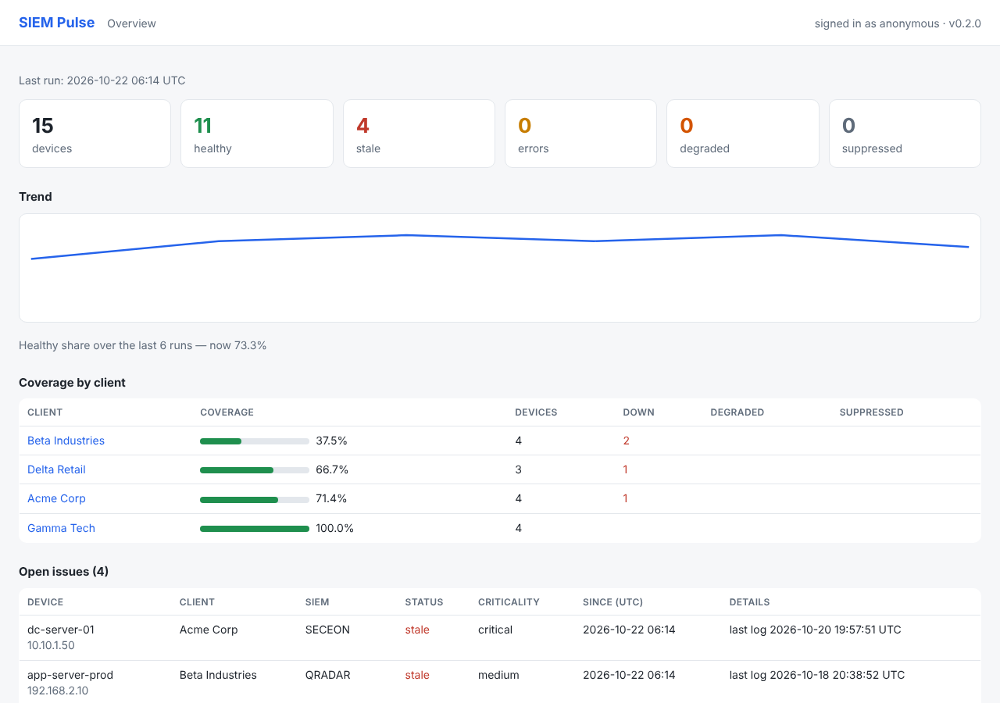

# Dashboard & metrics

```bash
siem-pulse --dashboard                # http://127.0.0.1:8080
siem-pulse --schedule --dashboard     # checks and dashboard in one process
```



The dashboard reads the run history: summary cards, trend, coverage per client, open issues, ATT&CK blind spots and a page per client. It uses only the Python standard library, loads no external assets and sends strict security headers.

## Access control

```yaml
dashboard:
  host: 127.0.0.1
  port: 8080
  users:
    - {name: soc,  token_secret: DASHBOARD_TOKEN_SOC,  clients: "*"}
    - {name: acme, token_secret: DASHBOARD_TOKEN_ACME, clients: ["Acme Corp"]}
  allow_anonymous: false
  metrics_public: false
```

Open `/?token=<token>` once (stored in an HttpOnly cookie) or send `Authorization: Bearer <token>`. A client-scoped user sees only their devices — in pages, the API and metrics. Without users, the dashboard refuses to listen on anything but localhost unless `allow_anonymous: true`.

## API

`/api/summary`, `/api/issues`, `/api/runs` return JSON. `/healthz` (no auth) returns 200 when a run finished within `heartbeat.max_age_minutes` (default 2 × interval + 5) and 503 otherwise.

## Prometheus

`/metrics` exposes `siem_pulse_up`, `siem_pulse_last_run_timestamp_seconds`, `siem_pulse_last_run_duration_seconds`, `siem_pulse_devices{client,siem,status}`, `siem_pulse_client_coverage_score{client}` and `siem_pulse_device_hours_since_last_log{client,device,siem}` (`metrics.per_device: false` to drop the last one). Scrape it with a bearer token, or set `metrics_public: true`. Without a long-running process, write the same text to a node_exporter textfile after each run with `metrics.textfile`. A ready-made Grafana dashboard is in `deploy/grafana/siem-pulse-dashboard.json`.

## Is the monitor alive?

- `heartbeat.ping_url`: pinged after every run (`/fail` on a crash) — works with Healthchecks.io, Cronitor, Uptime Kuma push monitors.
- `siem-pulse --check-heartbeat` from a separate cron/timer alerts your default channels once when runs stop, and exits 2.
- `logging.format: json` for log shippers.
