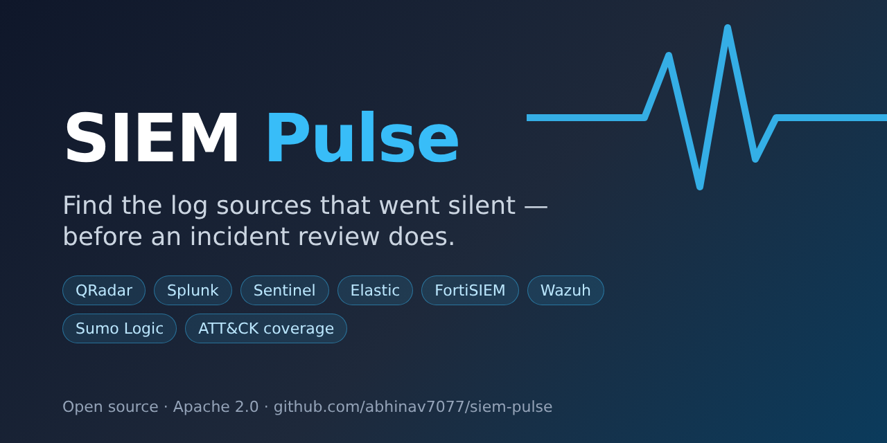

# SIEM Pulse



**SIEM Pulse is an open-source log source health monitor for SOC and MSSP teams.** It finds devices that stopped sending logs to your SIEM — and devices whose logs are arriving but broken — across many client environments, and alerts the right people.

A firewall or domain controller that goes quiet is a blind spot: attacks on it go undetected, and nobody notices until an incident review. SIEM Pulse turns the daily "is everything still logging?" check into an automated, scheduled SIEM health check.

## What it does

- **Checks every device's last log time** in IBM QRadar, Splunk, Microsoft Sentinel, Elastic / OpenSearch, FortiSIEM, Wazuh, Sumo Logic and Seceon — or any platform with a REST API — using one bulk query per SIEM tenant.
- **Alerts on change only**: new issue, reminder, recovered. Email, Slack, Microsoft Teams, PagerDuty, Opsgenie, ServiceNow, Jira or any webhook (SOAR), routed per client and criticality.
- **Catches "alive but broken" sources**: volume drops against a 7-day baseline, missing log types, unparsed events, clock skew.
- **Shows coverage**: a criticality-weighted score per client and the MITRE ATT&CK data sources left blind.
- **Built for MSSPs**: per-client endpoints and credentials (never shared across clients), secrets managers, ServiceNow CMDB inventory, a dashboard where each customer sees only their own devices.
- **Easy to run**: `pip install siem-pulse`, Docker, Helm, Kubernetes CronJob or a systemd timer. Mock mode lets you try everything without a SIEM.

## Try it in one minute

```bash
pip install siem-pulse
mkdir siem-pulse && cd siem-pulse
siem-pulse --init          # starter config.yaml, .env.example, sample inventory (mock mode)
siem-pulse                 # one check cycle
siem-pulse --dashboard     # http://127.0.0.1:8080
```

Next: [Getting started](getting-started.md) · [Connect your SIEM](siems/index.md) · [Set up alerts](alerting.md)

SIEM Pulse is licensed under the [Apache License 2.0](https://github.com/abhinav7077/siem-pulse/blob/main/LICENSE).
